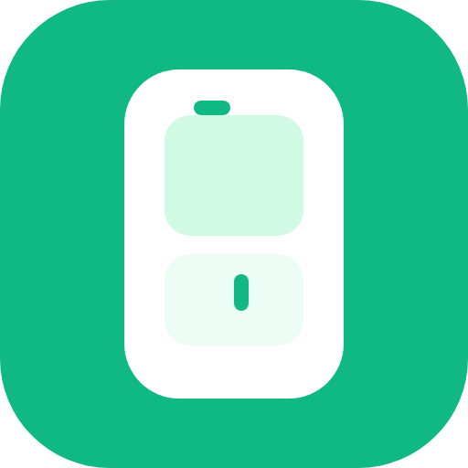

<div align="center">




<h1>MyFridge</h1>

<p>
  <strong>Your fridge, finally smart.</strong><br/>
  <em>Scan it in. Track it down. Eat it before it expires.</em>
</p>

<p>
  
  
  
  
  
  
  
</p>

<sub>
  <a href="#what-it-does">What it does</a> ·
  <a href="#stack">Stack</a> ·
  <a href="#getting-started">Getting started</a> ·
  <a href="#layout">Layout</a> ·
  <a href="#conventions">Conventions</a>
</sub>

</div>

---

MyFridge is a digital fridge — a progressive web app that turns the chaos behind that humming door into something
searchable, shareable, and a little bit kinder to your wallet. Scan a barcode. Watch the product appear, complete with
nutrition data and a Nutri-Score. Set when it expires. Get a nudge before it goes bad. Share the whole thing with
your partner, your flatmates, your future self.

It is built for one fridge, for one family, for one person who is tired of finding furry yoghurt at the back of the
top shelf — not for ten thousand tenants. The priorities are mobile-first, offline-tolerant, installable, and quiet.

---

## What it does

- **Scan products into your fridge.** Point your camera at any EAN-13, EAN-8, UPC-A, or UPC-E barcode. MyFridge resolves
  it through the [Open Food Facts](https://world.openfoodfacts.org/) database, caches the result, and drops the item
  into the right category.
- **Track quantities and expiry.** Edit how many you have, when they expire, jot a note. The app surfaces what is
  expiring soon and what has already turned.
- **Add things by hand.** No barcode? No problem. The manual product flow lets you add anything — leftover lasagna,
  the lemons from the market — with a category and a date.
- **See how you eat.** A quantity-weighted Nutri-Score for the whole fridge and a calculated health score that updates
  as you add and remove items.
- **Shopping list per fridge.** What's running low goes on the list. Tick it off as you shop.
- **Share by email.** Invite someone to a fridge and they get full access from their account.
- **Expiration alerts.** A daily cron at 8 AM checks every fridge and pushes notifications to anyone whose food is
  about to give up.
- **Speaks two languages.** English and German, with `next-intl` and a `[locale]` segment in the URL.
- **Works offline.** Service worker, cached product lookups, and Firestore's multi-tab persistent cache keep the app
  alive on the train.
- **Installs to your home screen.** It's a PWA. Add to Home Screen and it lives next to your other apps.

---

## Stack

| Layer | Choice |
| --- | --- |
| Framework | Next.js 16 (App Router, React 19.2) |
| Styling | Tailwind v4 |
| Auth | Firebase Auth (email/password + Google, behind a same-origin OAuth proxy) |
| Database | Firestore (client SDK with persistent multi-tab cache + Admin SDK on server) |
| Type safety | Zod schemas with Firestore `withConverter` |
| Forms | react-hook-form + `@hookform/resolvers/zod` |
| State | Zustand (for modal/dialog UI state) |
| Scanning | html5-qrcode |
| Notifications | Firebase Cloud Messaging + `react-hot-toast` |
| Product data | `@openfoodfacts/openfoodfacts-nodejs` |
| Service worker | Serwist |
| i18n | next-intl |
| Hosting / Cron | Vercel |

---

## Getting started

You'll need Node 20+ and a Firebase project of your own.

```bash
npm install
npm run dev
```

The dev server runs over HTTPS (Next's `--experimental-https`) on `https://localhost:3000`.
### Environment

You'll need a `.env.local` with your public Firebase config, Firebase Admin credentials for the server side, and a
`CRON_SECRET` for the Vercel daily expiration job. Public config is exposed to the browser, admin credentials never
leave the server.

---

## Layout

| Path | What lives there |
| --- | --- |
| `app/[locale]/` | Localized pages: fridges, shopping-list, scanner, settings, login, register |
| `app/api/cron/` | Daily expiration-alerts job |
| `app/api/notifications/` | FCM send endpoints |
| `app/api/openfoodfacts/` | Server-side product lookup |
| `app/sw.ts` | Serwist service worker entry |
| `components/` | `AuthGate`, `ScannerModal`, `ManualProductModal`, `ui/` primitives, feature folders |
| `contexts/` | React context providers |
| `hooks/` | Shared hooks |
| `i18n/` | next-intl config |
| `lib/` | Firestore refs, schemas, services, OFF client, utilities |
| `messages/` | `en.json`, `de.json` |
| `stores/` | Zustand stores for UI state |
| `firestore.rules` | Security rules: ownership + email-based sharing |
| `firestore.indexes.json` | Composite index definitions |
| `proxy.ts` | OAuth proxy entry (avoids third-party cookie blocking) |
| `vercel.json` | Cron schedule |
